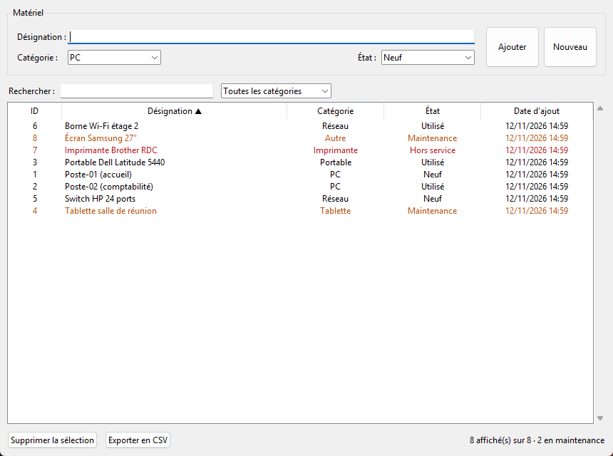

# PyAsset — Gestion du patrimoine informatique


Application de bureau en **Python** pour inventorier le matériel informatique d'une organisation : postes, portables, tablettes, équipements réseau, imprimantes…
Pensée pour un technicien de proximité : tout est stocké dans une base **SQLite** locale, sans serveur ni installation.

> Projet réalisé pour le BTS SIO option SLAM (épreuve E6).



## Fonctionnalités

- **Ajout, modification et suppression** de matériel. Un clic sur une ligne la charge dans le formulaire ; la suppression accepte plusieurs lignes à la fois, avec confirmation.
- **Recherche instantanée** par désignation et **filtre par catégorie**.
- **Tri** du tableau en cliquant sur les en-têtes de colonnes (sans tenir compte des majuscules ni des accents).
- **Mise en évidence** du matériel en maintenance (orange) ou hors service (rouge), avec un compteur dans la barre d'état.
- **Export CSV** des lignes affichées, directement lisible dans Excel (accents et séparateur `;`).

## Lancer l'application

Python 3.8 ou plus suffit : Tkinter et SQLite sont inclus dans Python, il n'y a aucune dépendance à installer.

```bash
git clone https://github.com/Vador634/Patrimoine_Projet_py.git
cd Patrimoine_Projet_py
python Patrimoine.py
```

La base `inventaire.db` est créée automatiquement à côté du script au premier lancement.

> Sous Linux, Tkinter s'installe parfois à part : `sudo apt install python3-tk`.

## Tests

La logique d'accès aux données est séparée de l'interface, ce qui permet de la tester sans ouvrir de fenêtre :

```bash
python -m unittest discover -s tests -v
```

Les tests couvrent l'ajout, la validation, la modification, la suppression multiple, la recherche et le filtre, la résistance aux injections SQL, l'export CSV et le tri.

## Base de données

Une table `materiel` :

| Colonne | Type | Description |
| :--- | :--- | :--- |
| `id_materiel` | INTEGER | Clé primaire auto-incrémentée |
| `designation` | TEXT | Nom ou modèle de l'équipement (100 caractères max.) |
| `categorie` | TEXT | PC, Portable, Tablette, Réseau, Imprimante ou Autre |
| `etat` | TEXT | Neuf, Utilisé, Maintenance ou Hors service |
| `date_ajout` | TEXT | Date d'enregistrement (format ISO) |

## Choix techniques

- **Requêtes paramétrées** (`?`) pour toutes les requêtes SQL, ce qui protège des injections. Les caractères `%` et `_` saisis dans la recherche sont échappés.
- **Connexions toujours fermées** grâce à `contextlib.closing`. Un simple `with sqlite3.connect()` valide la transaction mais ne ferme pas la connexion.
- **Séparation données / interface** : les fonctions `ajouter_materiel`, `modifier_materiel`, `charger_inventaire`… ne dépendent pas de Tkinter.
- **Validation** des champs (désignation obligatoire, catégorie et état parmi les valeurs autorisées).

## Structure

```
Patrimoine.py            Application : accès aux données + interface Tkinter
tests/test_patrimoine.py Tests unitaires (unittest)
docs/capture.png         Capture d'écran
Documentation/           Manuel utilisateur et manuel technique (.docx)
```

## Auteur

**Kilian Carasco** — étudiant en Bachelor Concepteur Développeur d'Applications (EPSI Bordeaux)
[GitHub](https://github.com/Vador634) · [LinkedIn](https://www.linkedin.com/in/kilian-carasco-029915399/)
